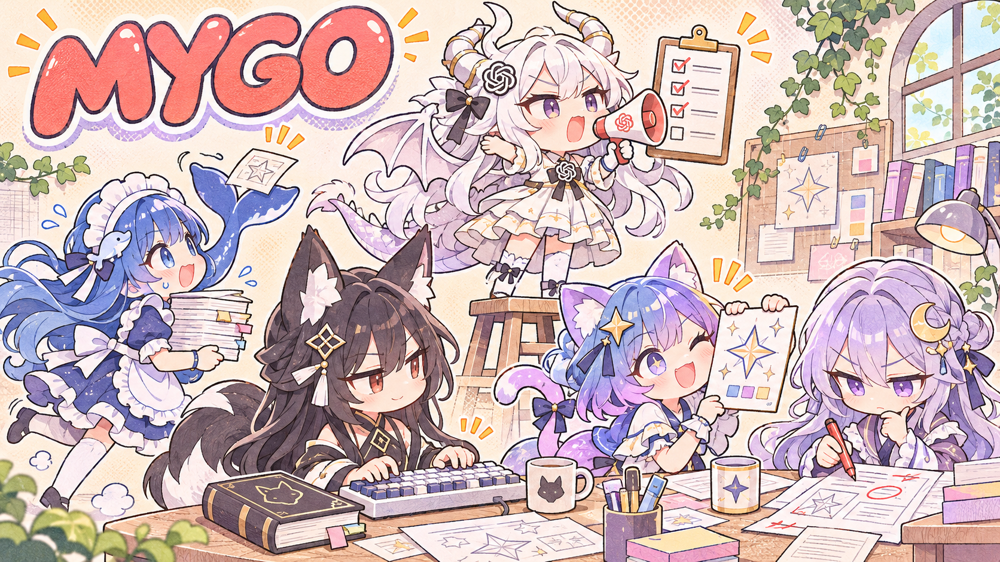

# MYGO



[简体中文](README.md)

MYGO is a Codex plugin for working with several models in one chat. When a test fails, DeepSeek can find the error, GLM can draft a fix, and Luna can apply it. The Codex model you’re talking to assigns the work, checks the result, and reports back.

## Install

Open Codex on the computer where you want to use MYGO and send this message:

> Install and configure the MYGO plugin from the GitHub repository EliotOK/Multiagent-Yield-optimized-General-Orchestrator. Check for an existing Magpie installation and local provider keys first. Tell me when I need to enter a key or restart Codex. Once it’s ready, ask a native DeepSeek subagent in this chat to calculate 17 × 23.

Guided setup supports Windows x64 with a recent Codex Desktop release and Python 3.11 or later. Enter keys in the local password window. To verify the setup, open **DeepSeek’s child chat** and look for its answer, **391**. On macOS and Linux, configure Magpie manually first. [Manual setup and routing guide](mygo/references/model-routing.md)

<details>
<summary>Install or update from the terminal</summary>

```powershell
codex plugin marketplace add EliotOK/Multiagent-Yield-optimized-General-Orchestrator
codex plugin add mygo@mygo
```

Reopen Codex and send `$mygo open MYGO settings`. Follow the panel prompts to connect your providers and enable native subagents. For future updates, click **检查更新** in the settings panel. The header shows the running version. Restart Codex when the panel reports that a newer version has been installed. You can also run `codex plugin marketplace upgrade mygo`.

</details>

## Use it in a chat

Start a request with `$mygo`. Let Codex choose the team, or name the models you want:

> $mygo A test started failing after the last update. Have DeepSeek find the first error in this public test log, GLM suggest the smallest fix, and Luna apply it and rerun the test. Tell me what broke and whether the fix worked.

By default, **DeepSeek** searches logs and sources, **GLM** drafts code, **Luna** edits files and runs tests, **Kimi** plans and reviews, and **Gemini** writes and gives design feedback. To change a model or its role, send `$mygo open MYGO settings`, make your selections under **模型与分工**, and click **保存分工**.

To use another provider such as Qwen, open **供应商密钥**, choose **添加供应商**, and refresh the panel after adding your key. Pick a connected model for a role and sync the selected models when prompted.

When a provider releases a new model, click **刷新模型列表** under that provider. Pick the model in **模型与分工** and sync it when prompted. **同步 Codex 模型菜单** refreshes the chat picker so it shows the built-in Codex models and synced models available in MYGO.

External models receive the material assigned to them. To limit what you share, say so in the request, for example “Send only this log excerpt to DeepSeek.”

[Legacy PowerShell workflow](mygo/references/legacy-workflow.md) · [Report a security issue](SECURITY.md) · [Code license](LICENSE)

AI-generated cover illustration based on [ZipZipPipe’s AI character series](https://www.bilibili.com/opus/1233069202138464289). The original DeepSeek whale character was created by 上善无形.
